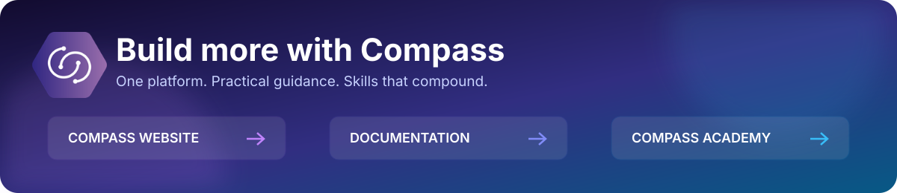

  
   
  <strong><a href="https://www.compassap.ai/">Compass Website</a> · <a href="https://www.compassap.ai/docs">Compass Documentation</a> · <a href="https://www.compassap.ai/academy">Compass Academy</a></strong>

# Nova Twix

**Stay in the conversation. Record your meetings, turn speech into text, and review who said what — with audio and speech processing kept on your computer.**

[Download Nova Twix](../../releases) · [Report a bug](../../issues) · [Suggest a feature](../../issues)

---

## Your meetings, easier to revisit

You do not need to remember every word or replay an entire meeting to check a detail. Nova Twix brings recording, readable transcripts, speaker labels, and exports into one desktop app.

| What you can do | How it helps |
| --- | --- |
| **Capture both sides of the conversation** | Record your microphone and the audio playing on your computer. |
| **Turn recordings into text** | Read through the discussion instead of listening to it all again. |
| **Follow who said what** | Review speaker-labelled text and edit speaker names. |
| **Keep working offline** | Transcribe locally once the required models are downloaded and verified. |
| **Pick up where you left off** | Cancel processing when needed and resume after restarting the app. |
| **Take your transcript with you** | Export plain text, Markdown, JSON, or SRT subtitles. |
| **Manage your recordings** | Delete a session in the app to remove its local audio and generated files. |

## Get started

### 1. Install Nova Twix

Open the [releases page](../../releases), choose a release, and download its installer. The application currently supports **Windows 10 and 11, 64-bit**. Check the release notes for available downloads and any installation guidance.

### 2. Prepare transcription once

In **Settings**, save your authorised Compass API key and choose a local processing model. Check the download size, select **Download and verify model**, and wait for **Offline ready**.

You need internet access and a Compass API key for the model download, but **you do not need a separate Hugging Face account or token**. Once a compatible model is installed and verified, you can process recordings offline without a key. Recording and reviewing existing transcripts do not require a model download.

### 3. Record your conversation

Choose your microphone and computer audio device, make sure everyone agrees to be recorded, and start recording. Stop from the app or its system tray control when the conversation ends.

### 4. Read, review, and export

Start processing to create your transcript. Review the text and speaker names, then export in the format that suits your next step.

## From conversation to something useful

- **Team meetings:** revisit a discussion when you need to check exactly what was said.
- **Interviews:** follow each speaker's contributions without replaying the whole recording.
- **Project handovers:** keep a readable reference alongside your working notes.
- **Captions and other tools:** export SRT subtitles or use text, Markdown, and JSON in your own workflow.

## Your recordings stay local

Nova Twix records and processes speech on your computer, with **no cloud fallback for transcription**. Compass receives authentication and model-download metadata, not your recordings or transcripts.

Your Compass credentials are kept in Windows Credential Manager, separate from your recordings and transcripts. You control when to export your content and can delete sessions from within the app.

Processing speed depends on your computer and the length of the recording. Automatic transcripts and speaker labels can contain mistakes, so check important details against the audio.

**Always obtain the necessary consent before recording.** Recording rules vary by location; an in-app reminder does not replace your responsibility to follow them.

## Questions before you start

**Does it need an internet connection?**

For the initial model download, yes. Recording, reviewing transcripts, and processing with verified installed models can work offline.

**Do I need to set up developer tools?**

Use a published installer from the releases page. This repository is for downloads and feedback, not for building the application yourself.

**Can I share the transcript?**

Yes — export plain text or Markdown for reading and notes, SRT for subtitles, or JSON for other tools. Check that you have permission before sharing meeting content.

**Does it work on macOS or Linux?**

The application currently supports Windows 10 and 11, 64-bit. Do not assume support for another platform unless a future release explicitly announces it.

## Feedback and ideas

Found something that does not work, or have an idea for making Nova Twix better? [Open an issue](../../issues).

- **For a bug:** include your operating system, app version, what happened, and what you expected.
- **For an idea:** describe what you are trying to do and how the change would help.

Please do not include private recordings, transcripts, API keys, or other sensitive information in public issues.

## About this repository

This is the home for Nova Twix downloads, release notes, and feedback. The application source code is maintained separately in a private repository.

## License

[MIT](./LICENSE) © 2026 Brighten SA.
